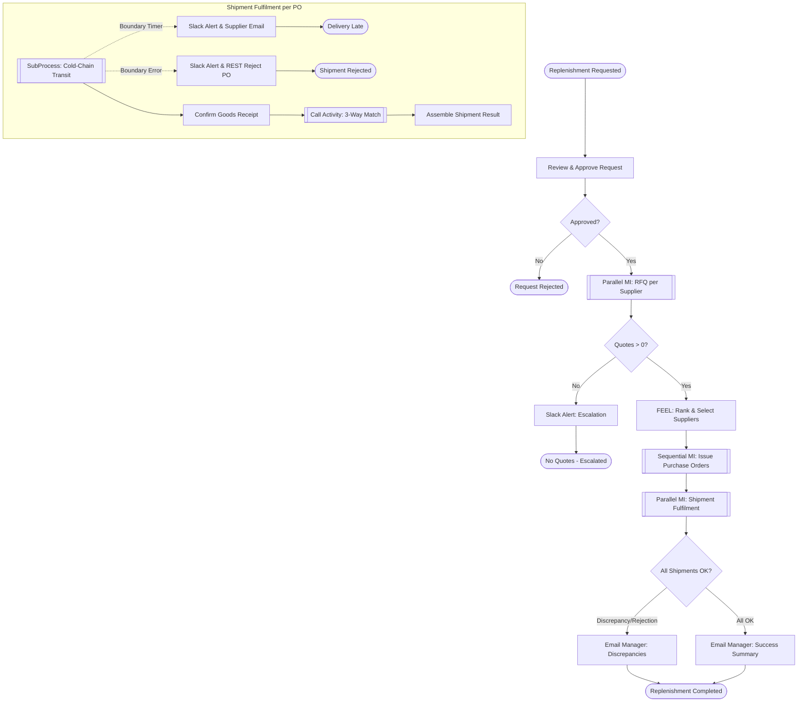

# Academic Report Draft: Chapter 2 & Section 4.3
## Perishable Cold-Chain Grocery Replenishment (Project 20)
### System Design, BPMN 2.0 Architecture, and Data Contracts

---

## 2.1 Process Architecture Overview

In modern grocery logistics networks—epitomized by Ocado and Carrefour—perishable inventory replenishment demands deterministic orchestration across distributed suppliers, rigorous cold-chain tracking, and strict financial reconciliation. Project 20 realizes this operational capability through an enterprise-grade Camunda 8 (Zeebe) BPMN 2.0 architecture.

The solution is partitioned into a master orchestration process (`coldChainReplenishment`) and a reusable sub-process (`supplierInvoiceThreeWayMatch`). The architecture operates under three foundational tenets:
1. **Asynchronous Parallel Quotation**: Store replenishment requests dynamically fan out to approved regional dairy and produce suppliers simultaneously via parallel multi-instance processing.
2. **Deterministic Financial Commitment**: Purchase orders are dispatched sequentially in price-ranked order, ensuring that supplier selection strictly respects the store's allocated budget ceiling without race conditions.
3. **Resilient Cold-Chain Integrity**: Real-time IoT sensor telemetry is integrated via REST and event-driven sub-processes to intercept and triage temperature excursion breaches (ambient temperatures exceeding 8°C) before spoiled produce enters the store's inventory.



---

## 2.2 Implementation of Mandatory Constructs

To meet the rigorous academic criteria, the architecture implements all mandatory BPMN 2.0 patterns natively executable on Zeebe:

### 1. Parallel Multi-Instance Sub-Process (`SubProcess_RFQPerSupplier`)
- **Cardinality**: Dynamic, bound to `=suppliers`.
- **Concurrency**: Parallel (`isSequential="false"`).
- **Execution Mechanism**: Each supplier in the input collection triggers an independent execution instance. The instance dispatches an automated outbound email with an RFQ specification and enters a dedicated wait sub-process (`SubProcess_WaitForQuote`) awaiting an asynchronous `QuoteReceived` message correlated on `requestId + "-" + supplier.supplierId`.
- **Aggregation**: Local instances output an individual `quote` object, collected into a process-level collection `quotes` for downstream ranking.

### 2. Sequential Multi-Instance Sub-Process (`SubProcess_IssuePurchaseOrders`)
- **Cardinality**: Dynamic, bound to `=selectedOrders`.
- **Concurrency**: Sequential (`isSequential="true"`).
- **Domain Justification**: Sequential execution is mandatory because capital expenditure against the store's `budgetCap` must be committed deterministically. If two suppliers are selected, the primary low-cost supplier's PO must be acknowledged by the supplier API before allocating residual budget to secondary suppliers.

### 3. Nested Sub-Processes with Error & Timer Boundary Events
- **Scope**: Nested inside each shipment instance as `SubProcess_ColdChainTransit`.
- **Boundary Timer Event (`BoundaryEvent_DeliveryTimer`)**: Configured with `PT5M` (demo) / `P2D` (production). An interrupting timer attached to the transit sub-process monitors supplier delivery SLAs. If transit exceeds the SLA window without a `ShipmentDelivered` message, the sub-process is terminated, firing a Slack notification to QA and sending an email notice of breach to the supplier.
- **Boundary Error Event (`BoundaryEvent_ShipmentRejected`)**: Catches the specific BPMN error `SHIPMENT_REJECTED`. This event catches rejections originating either from post-delivery physical inspections or live IoT excursion decisions. It directs the flow into an automated supplier restitution sequence (marking the PO rejected in the supplier portal and opening an accounting dispute).

### 4. Non-Interrupting Event Sub-Process (`EventSubProcess_TempExcursion`)
- **Trigger**: Non-interrupting Message Start Event (`isInterrupting="false"`) subscribing to message `TempExcursionDetected` with correlation key `=poResult.poNumber`.
- **Execution Mechanism**: Fires asynchronously in parallel with normal transit whenever trailer IoT sensors log temperatures > 8°C. It issues an immediate Slack alert to the QA triage desk and creates a user task `QA Excursion Decision`. If QA deems the excursion fatal to food safety, the event sub-process terminates with an **Error End Event** (`SHIPMENT_REJECTED`), which escalates to the enclosing `SubProcess_ColdChainTransit` and cancels the transit token.

### 5. Reusable Call Activity (`CallActivity_ThreeWayMatch`)
- **Target**: Reusable child process `supplierInvoiceThreeWayMatch`.
- **Scoping Rule**: Configured with `propagateAllChildVariables="false"` and `bindingType="latest"`. All required variables are explicitly mapped in and out via `zeebe:ioMapping`, ensuring absolute isolation between procurement orchestration and accounts payable reconciliation.

---

## 2.3 Failure-Handling Architecture

In perishable logistics, failure modes are multifaceted, spanning logistical delays, physical spoilage, and billing variances. The architecture addresses each with dedicated failure paths:

```
┌──────────────────────────────────────┬───────────────────────────────┬────────────────────────────────────────────────────────┐
│ Failure Mode                         │ BPMN Mechanism                │ Automated Mitigation / Recovery Action                 │
├──────────────────────────────────────┼───────────────────────────────┼────────────────────────────────────────────────────────┤
│ Supplier RFQ Timeout                 │ Interrupting Timer Boundary   │ Fallback to quote = {responded: false}; gateway routes  │
│                                      │ on Wait Sub-Process (PT2M)    │ to Slack escalation if 0 valid quotes returned.        │
├──────────────────────────────────────┼───────────────────────────────┼────────────────────────────────────────────────────────┤
│ Delivery SLA Exceeded                │ Interrupting Timer Boundary   │ Cancels transit sub-process; alerts QA via Slack;      │
│                                      │ on Transit Sub-Process (PT5M) │ transmits formal SLA breach notice to supplier email.  │
├──────────────────────────────────────┼───────────────────────────────┼────────────────────────────────────────────────────────┤
│ Mid-Transit Temp Excursion (> 8°C)   │ Non-interrupting Message      │ Fetches live telemetry; alerts QA via Slack; presents  │
│                                      │ Event Sub-Process             │ QA task. If rejected, throws SHIPMENT_REJECTED error.  │
├──────────────────────────────────────┼───────────────────────────────┼────────────────────────────────────────────────────────┤
│ Post-Delivery QA Inspection Failure  │ Exclusive Gateway & Error     │ Throws SHIPMENT_REJECTED error end event; caught by    │
│                                      │ End Event                     │ parent sub-process boundary error event.              │
├──────────────────────────────────────┼───────────────────────────────┼────────────────────────────────────────────────────────┤
│ Cold-Chain Rejection Compensation    │ Boundary Error Event          │ Calls REST API to mark PO rejected; sends Slack alert; │
│                                      │ (SHIPMENT_REJECTED)           │ records status = "REJECTED", matchStatus = "DISPUTED". │
├──────────────────────────────────────┼───────────────────────────────┼────────────────────────────────────────────────────────┤
│ 3-Way Match Quantity/Price Variance  │ Script Task + User Task       │ AP Clerk manually overrides or disputes; disputes      │
│                                      │ in Call Activity              │ propagate to parent and notify store manager.          │
└──────────────────────────────────────┴───────────────────────────────┴────────────────────────────────────────────────────────┘
```

All exclusive gateways implement explicit default flows (`default="Flow_..."`) ensuring zero unhandled gateway splits and eliminating runtime stuck tokens.

---

## 2.4 FEEL and Variable Mapping Dictionary

### Process Variable Lifecycle Matrix

| Variable Name | Type | Scope | Produced By | Consumed By |
| :--- | :--- | :--- | :--- | :--- |
| `requestId` | String | Process (Global) | Process Start Payload | Review Task, Email Connectors, Correlation Keys |
| `storeId` | String | Process (Global) | Process Start Payload | Review Task, Email Connectors, Slack Alerts |
| `storeManagerEmail` | String | Process (Global) | Process Start Payload | Review Task, Summary Email Connectors |
| `maxTransitTempC` | Number | Process (Global) | Process Start Payload | QA Inspection, Excursion Event Sub-Process |
| `budgetCap` | Number | Process (Global) | Process Start Payload | Review Task, Rank & Select Script Task |
| `items` | List<Object> | Process (Global) | Process Start Payload | Review Task, Rank & Select Script Task, PO Payload |
| `suppliers` | List<Object> | Process (Global) | Process Start Payload | Review Task, RFQ Multi-Instance Loop |
| `requestApproved` | Boolean | Process (Global) | `Task_ReviewRequest` | `Gateway_RequestApproved` |
| `supplier` | Object | Sub-Process (MI-local) | Multi-Instance Input Element | Send RFQ Email, Correlation Key |
| `quotePrice` | Number | Sub-Process (MI-local) | Message `QuoteReceived` | Record Received Quote Script Task |
| `quote` | Object | Sub-Process (MI-local) | Script Tasks (Received / Timeout) | Multi-Instance Output Aggregation |
| `quotes` | List<Object> | Process (Global) | RFQ Sub-Process Collection Output | `Gateway_AnyValidQuote`, Rank Script Task |
| `selectedOrders` | List<Object> | Process (Global) | `Task_RankSelectSuppliers` | Sequential PO Multi-Instance Loop |
| `order` | Object | Sub-Process (MI-local) | Sequential MI Input Element | REST POST PO, Send Email PO Confirmation |
| `supplierOrderResponse` | Object | Sub-Process (MI-local) | REST Connector Header Result | Assemble PO Result Script Task |
| `poResult` | Object | Sub-Process (MI-local) | `Task_SetPOResult` | Sequential MI Output Collection |
| `poResults` | List<Object> | Process (Global) | Sequential MI Collection Output | Shipment Fulfilment Multi-Instance Loop |
| `telemetryData` | Object | Sub-Process (MI-local) | REST Connector Header Result | `Gateway_CheckTempExceeded`, QA Inspection |
| `qaInspectionPassed` | Boolean | Sub-Process (MI-local) | `Task_QAInspection` Form | `Gateway_QAInspectionPassed` |
| `excursionDetail` | Object | Event Sub-Process Local | REST Connector Header Result | Slack Alert, `Task_QADecision` Form |
| `qaExcursionDecision` | String | Event Sub-Process Local | `Task_QADecision` Form | `Gateway_ExcursionDecision` |
| `receivedQty` | Number | Sub-Process (MI-local) | `Task_ConfirmGoodsReceipt` | Call Activity Input Mapping |
| `invoiceNumber` | String | Sub-Process (MI-local) | `Task_ConfirmGoodsReceipt` | Call Activity Input Mapping |
| `invoiceAmount` | Number | Sub-Process (MI-local) | `Task_ConfirmGoodsReceipt` | Call Activity Input Mapping |
| `childMatchStatus` | String | Sub-Process (MI-local) | Call Activity Output Mapping | Assemble Shipment Result Script Task |
| `shipmentResult` | Object | Sub-Process (MI-local) | Script Tasks (Normal / Late / Reject) | Fulfilment MI Output Collection |
| `shipmentResults` | List<Object> | Process (Global) | Fulfilment MI Collection Output | `Gateway_ShipmentResultsSummary`, Summary Emails |

---

## 4.3 Multi-Instance and Call Activity Data Mappings

### 1. RFQ Parallel Multi-Instance Mapping
```xml
<zeebe:loopCharacteristics 
    inputCollection="=suppliers" 
    inputElement="supplier" 
    outputCollection="quotes" 
    outputElement="=quote" />
```
- **Input Scope**: Iterates over `suppliers: [{"supplierId": "SUP-A", "email": "a@...", ...}, ...]`.
- **Local Isolation**: Each instance references `supplier.email`, `supplier.name`, and `supplier.supplierId`.
- **Correlation Mapping**: Subscription key is dynamically resolved as `=requestId + "-" + supplier.supplierId`.
- **Output Aggregation**: Each branch emits `quote = { supplierId, price, responded }` into global array `quotes`.

### 2. Sequential Purchase Order Multi-Instance Mapping
```xml
<zeebe:loopCharacteristics 
    inputCollection="=selectedOrders" 
    inputElement="order" 
    outputCollection="poResults" 
    outputElement="=poResult" />
```
- **Input Scope**: Evaluated from sorted and budget-constrained orders produced by FEEL expression:
  ```feel
  =(for q in sort(quotes[item.responded = true], function(x, y) x.price < y.price)
    return {
      supplierId: q.supplierId,
      poNumber: "PO-" + requestId + "-" + q.supplierId,
      items: items,
      amount: q.price
    })[item.amount <= budgetCap]
  ```
- **Local Isolation**: Single active token at any given time executes REST POST and SMTP confirmation.
- **Output Aggregation**: Emits `poResult = { poNumber, supplierId, items, amount, poStatus }` into `poResults`.

### 3. Shipment Fulfilment Multi-Instance Mapping
```xml
<zeebe:loopCharacteristics 
    inputCollection="=poResults" 
    inputElement="poResult" 
    outputCollection="shipmentResults" 
    outputElement="=shipmentResult" />
```
- **Input Scope**: Fans out over dispatched purchase orders.
- **Isolation Guarantee**: Each instance operates over an isolated `poResult` object. Message catch events dynamically subscribe to `poResult.poNumber`.
- **Output Aggregation**: Collects `{ poNumber, supplierId, status, matchStatus }` into `shipmentResults`.

### 4. Call Activity I/O Boundaries (`supplierInvoiceThreeWayMatch`)
```xml
<bpmn:callActivity id="CallActivity_ThreeWayMatch" name="Supplier Invoice Three-Way Match">
  <bpmn:extensionElements>
    <zeebe:calledElement processId="supplierInvoiceThreeWayMatch" propagateAllChildVariables="false" bindingType="latest" />
    <zeebe:ioMapping>
      <zeebe:input source="=poResult.poNumber" target="poNumber" />
      <zeebe:input source="=sum(poResult.items.qty)" target="orderedQty" />
      <zeebe:input source="=poResult.amount" target="orderedAmount" />
      <zeebe:input source="=receivedQty" target="receivedQty" />
      <zeebe:input source="=invoiceAmount" target="invoiceAmount" />
      <zeebe:input source="=invoiceNumber" target="invoiceNumber" />
      <zeebe:output source="=matchStatus" target="childMatchStatus" />
    </zeebe:ioMapping>
  </bpmn:extensionElements>
</bpmn:callActivity>
```
- **Data Encapsulation**: Strict `propagateAllChildVariables="false"` prevents child calculation artifacts (`quantityVariance`, `amountVariance`, `isMatch`, `apDecision`, `apNotes`) from leaking into parent scope.
- **Target Child Process Variables**:
  - `isMatch = (receivedQty = orderedQty) and (abs(invoiceAmount - orderedAmount) <= (orderedAmount * 0.02))`
  - `matchStatus ∈ {"MATCHED", "MANUALLY_APPROVED", "DISPUTED"}`
- **Feedback Loop**: Only `matchStatus` is mapped back into `childMatchStatus`, maintaining high modularity.
